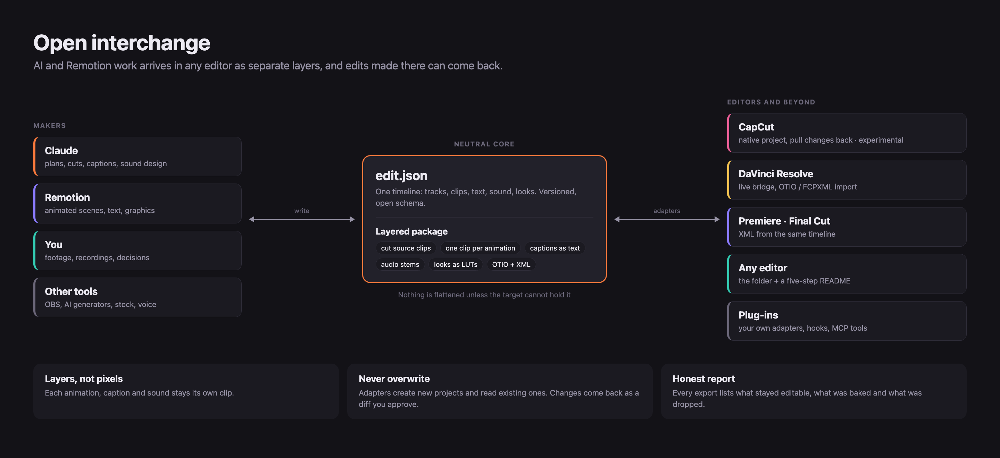

# Open interchange: keep AI + Remotion edits editable in CapCut and other editors

A separate track of work from the app itself (`PLAN.md`). Goal: whatever Claude and Remotion produce
arrives in an editor as **separate, movable layers on a timeline**, not as one flattened MP4, and changes
made in the editor can come back. CapCut is the first target; the design is open so Resolve, Premiere,
Final Cut and tools that do not exist yet plug in the same way.

Status on 2026-11-21: plan only. Facts checked on this Mac are marked ✅, assumptions ❓.



## 1. The problem in one picture

Today: `Remotion render → one MP4`. In CapCut that is a single clip: the captions, the graph animation,
the music and the cut points are baked in and cannot be changed.

Wanted: the same video opens in CapCut as a project with the speaker clip cut on the main track, each
animation as its own clip above it, captions as editable text, voice / music / SFX on their own audio
tracks. You move a caption, swap the music, trim a scene, and the AI can pick the project up again.

## 2. Principles

1. **Layers, not pixels.** Export keeps every element separate for as long as the target editor can
   represent it; only what it cannot represent is baked, and it is baked per element.
2. **One neutral timeline in the middle.** `edit.json` (see `PLAN.md` §4a) is the source of truth.
   Every editor is an adapter on the edge; no editor's format leaks into the core.
3. **Open formats first, private formats as adapters.** OpenTimelineIO (OTIO) is the published exchange
   format; FCPXML and EDL come from it. CapCut's draft format is private, so that adapter is isolated,
   versioned and allowed to fail without breaking anything else.
4. **Never touch the user's work.** Adapters write new projects/timelines; they never modify an existing
   CapCut draft or Resolve timeline in place. Round trips read, they do not overwrite.
5. **Degrade honestly.** Every export ends with a report: what stayed editable, what was baked, what was dropped.

## 3. The layered package (works with every editor, today's baseline)

`studio export "<project>" --layers` writes `projects/<name>/handoff/`:

```
handoff/
  timeline.otio            neutral timeline (tracks, clips, in/out, positions)
  timeline.fcpxml          same, for editors that import XML
  manifest.json            every file, its track, start, length, blend mode, what it was baked from
  video/   01-aroll-tight.mp4, 02-broll-city.mp4 …            source clips, already cut
  motion/  03-graph-up.mov, 07-quote.mov …                    one clip per animation (alpha where needed)
  text/    captions.srt, titles.json                          text kept as text
  audio/   voice.wav, music.wav, sfx/…                        stems, never mixed down
  looks/   scene-03.cube                                      grades as LUTs
  README.md                the five steps to rebuild it by hand in any editor
```

Remotion side: a `--layers` render mode in Motion Studio renders each scene/element of a composition to
its own file (alpha ProRes or MP4) instead of one video. That is the piece that makes everything else
possible, and it is useful even with no adapter at all: drag the folder into any editor and stack it.

## 4. Adapters

One interface, loaded as plug-ins (same shape as the app's `EditorAdapter`, extended):

```ts
interface InterchangeAdapter {
  id: string;                                   // 'capcut' | 'resolve' | 'fcpxml' | 'otio' | 'folder' | …
  detect(): Promise<{installed: boolean; version?: string; supported: boolean; notes: string[]}>;
  capabilities: {text: 'native' | 'baked'; captions: boolean; keyframes: boolean; blendModes: boolean;
                 luts: boolean; readBack: boolean};
  write(edit: EditDocument, pkg: LayeredPackage): Promise<HandoffReport>;   // creates a new project
  read?(ref: ProjectRef): Promise<EditPatch>;                               // editor → changes to edit.json
}
```

| Adapter | How | Editable result | Confidence |
|---|---|---|---|
| `folder` | the layered package + README | manual stacking, everything separate | certain |
| `otio` / `fcpxml` | OpenTimelineIO library writes both | Resolve imports OTIO/FCPXML; Premiere and Final Cut import XML | high; verify per editor |
| `resolve` | existing bridge (`build_edit`, import, captions, grade) | built timeline, live | proven for cuts/music/SFX; titles have an open bug |
| `capcut` | writes a new draft folder into CapCut's projects directory | native CapCut project | experimental, see §5 |
| future | Premiere (UXP), After Effects (Lottie/JSON), web editors, publishing tools | | open |

## 5. CapCut adapter

**What was checked here (CapCut 9.7.1, macOS).** ✅ Projects live in
`~/Movies/CapCut/User Data/Projects/com.lveditor.draft/<name>/`. ✅ `draft_info.json` is plain JSON with
`tracks`, `materials` (videos, audios, texts, stickers, transitions, speeds, color curves, hsl,
primary_color_wheels, …), `canvas_config`, `fps`, `duration`. ✅ `root_meta_info.json` lists the drafts.
❓ Only an empty draft exists on this machine, so the segment/material layout of a real edit, and whether
drafts with content stay unencrypted in this version, are not yet confirmed. There is no official
documentation or API; the format can change with any CapCut update.

**Phase C0, the spike (do this before promising anything):**
1. In CapCut, build a tiny reference project by hand: one video, one image, one text, one caption line,
   one music clip, one SFX, a split, a fade, a blend mode, a LUT.
2. Copy the draft folder; read `draft_info.json`; document every field the reference uses.
3. Write the same project from code into a new draft folder; open CapCut; compare. Repeat until identical.
4. Record the CapCut version; keep the reference draft as a golden test file.
Outcome decides the adapter's scope. If drafts turn out to be encrypted or rejected, the adapter falls
back to the layered package and this section is closed with that finding.

**Mapping (target):**

| From `edit.json` | To CapCut | Notes |
|---|---|---|
| Video clips with in/out, speed | segments on the main video track | native, fully editable |
| Animated scenes (Remotion) | one video segment per scene on an overlay track | baked per scene; position, length, opacity, blend stay editable |
| Simple titles and captions | native text segments / caption track | font, size, colour, position editable; our motion presets become a baked alternative when no CapCut equivalent exists |
| Voice, music, SFX | separate audio tracks with volume and fades | native |
| Beat markers | timeline marks / beats | if the format allows |
| Look | `.cube` applied as adjustment, or baked into the proxy | depends on C0 |
| Transitions | CapCut built-ins when there is a match, otherwise baked into the overlay clip | |

**Round trip (CapCut → Claude):** `studio pull capcut "<draft>"` reads the draft read-only and produces
an `EditPatch`: clips moved, trimmed, deleted, text changed, volumes changed. The patch is shown as a
diff and applied to `edit.json` only after approval; elements CapCut added that have no counterpart are
kept as "foreign" clips so nothing is lost. Claude then continues from the user's version.

**Safety:** write only new draft folders with a clear prefix; back up `root_meta_info.json` before
registering a draft; CapCut closed while writing; never edit a draft the adapter did not create; an
`undo` that removes exactly what was added. Check CapCut's terms of use before distributing the adapter
to other people; keep it a clearly labelled optional plug-in.

## 6. Open workflow: how other things plug in

- **Formats:** `edit.json` schema (JSON Schema published, versioned), OTIO, SRT/VTT, `.cube`, WAV stems.
- **Commands:** `studio export --to <adapter>`, `studio pull <adapter>`, `studio adapters` (list + detect).
- **For AI tools:** the same operations as MCP tools (`export_layers`, `handoff`, `pull_changes`), so any
  MCP client, not only Claude, can drive them.
- **Events:** a `hooks/` folder per project (`on-export`, `on-pull`, `on-render`) running user scripts,
  and a watch mode that reacts when an editor saves.
- **Plug-ins:** adapters are small packages implementing the interface in §4, discovered from a folder;
  a template repo and a conformance test (round-trip a reference project) make third-party ones possible.
- **Inputs too:** the same adapter idea for sources (OBS, phone import, stock libraries, AI generators,
  voice tools) and for outputs after the edit (publishing queues, review links).

## 7. Phases

| Phase | Work | Done when |
|---|---|---|
| I0 | `edit.json` schema v1 + validator; `--layers` render in Motion Studio | a MinimalStory or VoxStory project exports as separate clips + stems + SRT |
| I1 | Layered package + `folder` adapter + export report | the package rebuilt by hand in CapCut matches the flat render |
| I2 | `otio`/`fcpxml` adapters | Resolve opens the timeline with clips in place; other editors spot-checked |
| C0 | CapCut spike (§5) | written findings: format, encryption, version behaviour |
| C1 | CapCut writer: video, overlays, audio, fades | a generated draft opens in CapCut and every layer moves independently |
| C2 | Native text and captions, looks, markers | captions are editable text in CapCut |
| C3 | CapCut reader + `EditPatch` + approval diff | a trim made in CapCut shows up in `edit.json` after `pull` |
| I3 | Adapter plug-in API, MCP tools, hooks, conformance tests | an adapter written outside this repo passes the tests |
| I4 | In the app: "Send to…" and "Pull changes" with the report and diff | used from the UI |

I0 and I1 are worth doing regardless of how the CapCut spike turns out.

## 8. Risks

| Risk | Handling |
|---|---|
| CapCut changes or encrypts the draft format | adapter pinned to tested versions, golden files, automatic fallback to the layered package |
| A written draft corrupts CapCut's project list | new folders only, backup of the registry file, undo, CapCut closed while writing |
| Terms of use | optional plug-in, user's own projects only; review before publishing it |
| Baked animation clips are large (ProRes with alpha) | H.264 where no alpha is needed; alpha only for overlays; proxies |
| Round trip loses information | foreign clips are preserved; nothing is applied without the diff being approved |
| Scope | each phase is useful alone; C-phases can stop after C0 |
