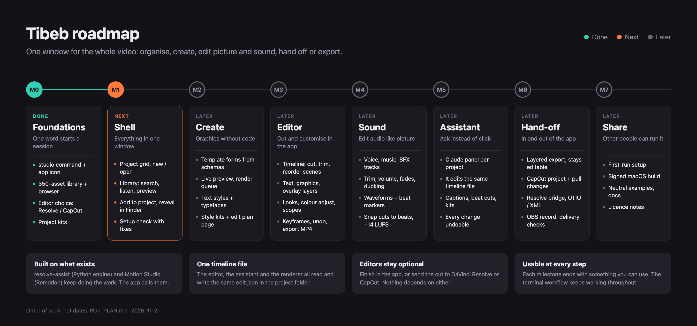
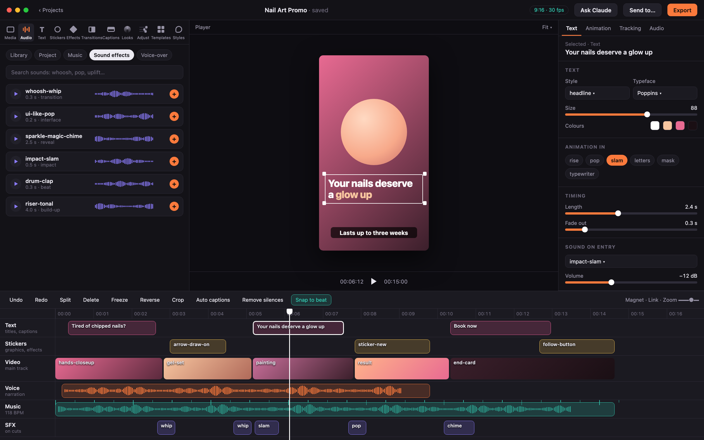
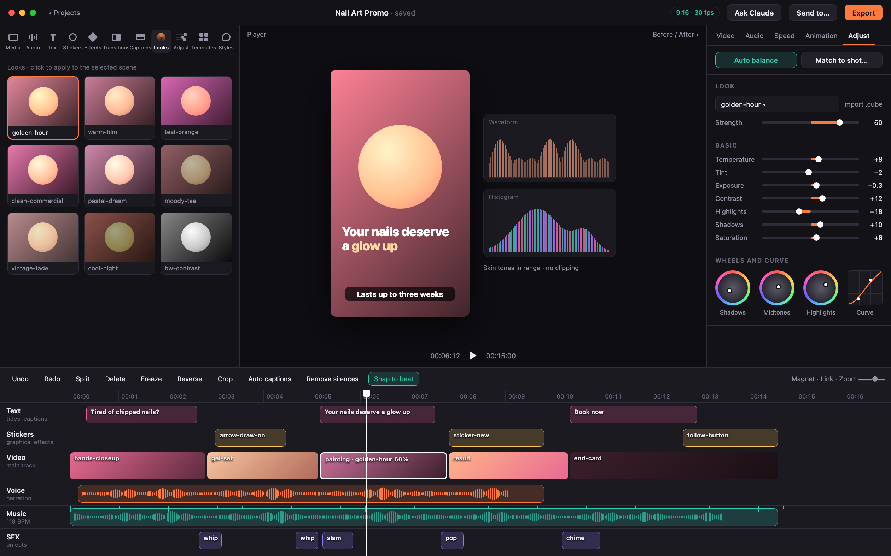
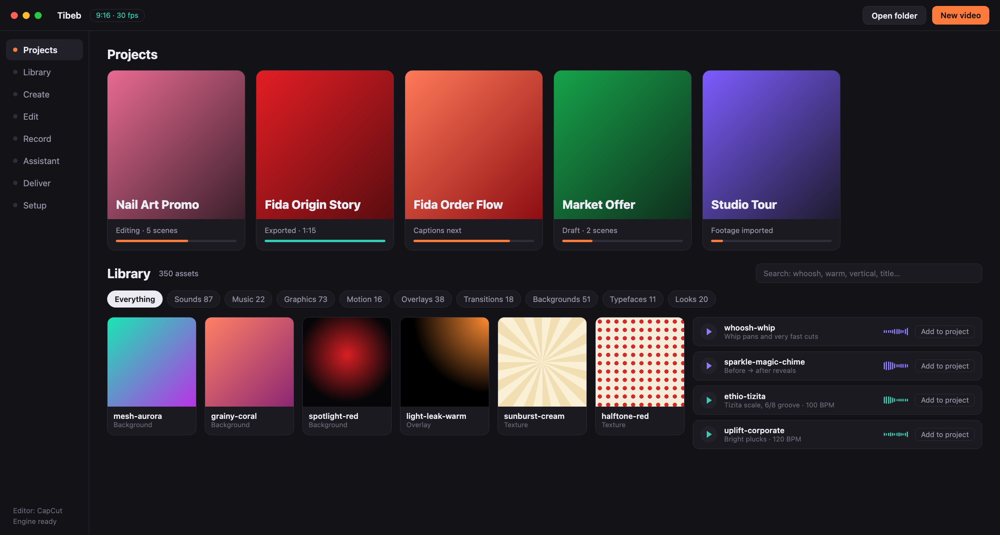

# Tibeb: plan

A desktop app (Electron) that puts the whole video workflow in one window: projects, the asset
library, motion templates, a built-in editor for picture and sound, recording, the AI assistant and
an optional hand-off to DaVinci Resolve or CapCut.
Name: **Tibeb** (ጥበብ, "craft"). Launcher commands: `tibeb` or `studio`.

Status on 2026-11-21: plan only. What exists today is listed under "Starting point".



How it would look (design mockups, not screenshots of a working app):







The images are generated from `design/index.tsx`; re-render with
`node_modules/.bin/remotion still design/index.tsx Roadmap docs/roadmap.png --scale=1.5` (same for `Editor`, `Color`, `Home`, `Interchange`).

Related plan: [INTERCHANGE.md](INTERCHANGE.md), the open workflow that keeps AI + Remotion edits editable in CapCut and other editors.

## 1. What it is, and what it is not

- **Is:** the place a video gets made. One icon → pick or create a project → everything for that video
  (footage, assets, graphics, captions, music, exports, notes, chat) is in one place, and it can be cut,
  customised and exported there.
- **Has its own editor, built on Remotion.** A timeline for scenes, text, graphics and sound with a live
  preview and an inspector for every property, in the spirit of Remotion Studio but without writing code.
  Short social videos (roughly 15 to 90 seconds, vertical) are the target.
- **Is not** a replacement for a finishing suite: no multicam, no node-based colour grading, no long-form
  editing. For those the cut is sent to Resolve or CapCut.
- **External editors are optional.** Resolve gets live control through the existing bridge. CapCut (no
  scripting API) gets a file hand-off: a kit folder, an `.srt`, a `.cube`, a cut list. "None" works too.
- **Local first.** Media never leaves the machine unless a feature says so (Higgsfield, publishing).
- **Wrap, don't rewrite.** resolve-assist (Python) and Motion Studio (Remotion) keep doing the work;
  the app calls them. Every feature stays usable from the terminal and from Claude Code.

## 2. Starting point (already built)

| Piece | Where | Role in the app |
|---|---|---|
| resolve-assist | `~/Documents/Github/resolve-assist` | Engine: analysis, grading, captions, beat edits, OBS, library build/search, kits, doctor. CLI prints JSON; MCP server for Claude |
| Motion Studio | `~/Documents/Github/motion-studio` | Remotion templates, text styles, typefaces, graphics; `npm run make -- <config>` |
| Workspace | `~/Documents/resolve-assist` | `projects/<name>/…`, `library/` + `manifest.json` + `index.html` browser |
| Launcher | `studio` command + `~/Applications/Studio.app` | Becomes the app's CLI (`studio new`, `studio kit`, …) |
| Higgsfield CLI, OBS, whisper.cpp, ffmpeg | system | Optional integrations, detected by `doctor` |

The library browser (`library/index.html`) is the prototype of the app's Library screen.

## 3. Screens

1. **Home / Projects**: grid of projects (cover frame, format, editor, status from `notes.md`), "New video".
2. **Project**: tabs for Files (footage, stills, music, exports), Kit (picked assets), Captions, Notes,
   Renders; buttons "Open in Resolve / CapCut", "Reveal in Finder"; drag files out to the editor.
3. **Library**: search, filter, listen, preview; "Add to kit", "Import to Resolve", favourites;
   typefaces with install button; LUT previews on the project's own frame.
4. **Create**: Motion Studio templates as forms generated from their Zod schemas, live preview
   (Remotion Player), render queue, output filed into the project or library.
4b. **Edit** (see §4a): assets panel, 9:16 preview, inspector, and a timeline with Text, Graphics, Video,
   Voice, Music and SFX tracks. Split, trim, reorder, delete; drag assets in; snap cuts to beats.
5. **Record**: OBS status, scenes, start/stop, recordings land in the project.
6. **Assistant**: Claude panel bound to the current project, with the resolve-assist tools available.
7. **Deliver**: export checklist (format, loudness −14 LUFS, safe zones, captions), optional publish queue.
8. **Setup**: doctor results with one-click fixes, editor choice, folders, credit balance (Higgsfield).

## 4. Architecture

```
Renderer (React + TypeScript, sandboxed, no Node)
   │  typed IPC through a preload script (allowlisted channels only)
Main process (Node)
   ├─ ProjectStore     reads/writes the workspace folders; file watcher; no database at first
   ├─ EngineClient     runs `resolve-assist <cmd>` (JSON out) as a child process, queued, cancellable
   ├─ MotionClient     runs Motion Studio renders (`node scripts/render.mjs`), streams progress
   ├─ Assistant        Claude Agent SDK session per project, MCP: resolve-assist
   ├─ EditorAdapter    resolve | capcut | none  (one interface, see §5)
   └─ Integrations     OBS (via engine), Higgsfield CLI, Buffer (optional, later)
```

Decisions and the reasoning:

- **Files are the database.** `projects/<name>/project.json` (format, editor, status, kit list) next to
  the media; `library/manifest.json` as today. Anything the app writes stays readable without the app.
  Add SQLite only if search over thousands of clips gets slow.
- **Engine as a sidecar process, not a rewrite.** Start with the existing JSON CLI (one process per
  call). If latency matters later, add `resolve-assist serve` (JSON lines over stdio) with the same
  functions; the MCP server already proves that shape.
- **Stack:** Electron (current stable) + Vite + React + TypeScript via Electron Forge; Zod for IPC
  payloads (Motion Studio already uses Zod, so template schemas can be imported directly).
- **Assistant:** Claude Agent SDK in the main process, working directory = workspace, so it reads the
  same `CLAUDE.md` guide as a terminal session. Fallback for v1: an embedded terminal (xterm.js +
  node-pty) running `claude` in the workspace, which is the fastest way to a working panel.
- **Media preview:** a custom `media://` protocol restricted to the workspace and library folders,
  instead of `file://` access from the renderer.

## 4a. The built-in editor

**One timeline file.** Each project has `edit.json`: the single description of the video that the editor
UI, the assistant and the renderer all read and write.

```jsonc
{
  "format": "9x16", "fps": 30,
  "tracks": [
    {"id": "video", "kind": "video", "clips": [
      {"id": "c1", "src": "footage/hands.mp4", "start": 0, "in": 2.4, "out": 5.2, "speed": 1,
       "transform": {"scale": 1.1, "x": 0, "y": 0}, "look": "golden-hour", "transitionIn": "flash-white"}]},
    {"id": "text", "kind": "text", "clips": [
      {"id": "t1", "start": 5.2, "length": 2.4, "text": "Your nails deserve a glow up",
       "style": "headline", "typeface": "poppins", "motion": "slam", "sfx": "impact-slam"}]},
    {"id": "music", "kind": "audio", "clips": [
      {"id": "m1", "src": "library:chill-house-30s", "start": 0, "in": 0, "out": 15,
       "volume": -8, "fadeIn": 0.3, "fadeOut": 1.5, "duck": {"under": "voice", "by": -9}}]}
  ],
  "captions": {"src": "captions/video.srt", "style": "caption"}
}
```

**How it renders.** One generic Remotion composition (`Timeline`) in Motion Studio takes `edit.json` as
props and lays out `<Sequence>`, `<Video>`, `<Audio>`, `StyledText`/`AnimatedText`, graphics and
overlays. The same composition drives the in-app preview (Remotion Player) and the final export
(Remotion render, then the existing −14 LUFS pass), so what is previewed is what is exported.

**Picture: what can be edited**
- Scenes: add, split at the playhead, trim in/out, reorder, delete, speed, freeze frame, crop/scale/position.
- Layers: text (18 styles, 11 typefaces, 15 motions), graphics and animated overlays from the library,
  transitions on cuts, looks from the LUT library, captions from the local transcription.
- Everything selected shows its properties in the inspector; templates from Create can be dropped in as clips.

**Sound: what can be edited**
- Tracks for voice, music and SFX. Per clip: trim, move, volume, fade in/out, mute, loop.
- Ducking (music dips under voice), volume keyframes, SFX attached to a cut or to a text entry.
- Waveforms on the timeline, beat markers from the engine's analysis, "snap cuts to beats".
- Sound design tools from the engine: generate music at the exact length, change tempo-matched presets,
  normalise loudness. Recording voice-over into a track comes with the Record milestone.
- Deeper audio work (noise removal, EQ, multitrack mixing) is out of scope at first; clips can be opened
  in an external audio editor and are picked up again on save.

**Engineering notes**
- Edits are small operations on `edit.json` (split, trim, move, set-property) kept in an undo stack and
  autosaved; the assistant uses the same operations, so its changes are visible and undoable.
- Large phone footage needs proxies (ffmpeg, made on import) for smooth preview; export uses the originals.
- Waveforms and thumbnails are generated once by the engine and cached in the project folder.
- Hand-off still works after editing in the app: Resolve gets a built timeline through the bridge
  (`build_edit` already takes segments), CapCut gets the rendered video plus the kit.
- Build order: read-only timeline + preview first, then trim/split/move, then text and graphics layers,
  then audio controls. Each step is usable alone.

## 4b. Look and feel: familiar from CapCut

The editor follows the layout people already know from CapCut, so there is nothing to learn:

- **Top-left tool tabs:** Media, Audio, Text, Stickers, Effects, Transitions, Captions, Looks, Adjust,
  Templates, Styles. Each opens a browser of items with a "+" to add at the playhead.
- **Centre player**, **right inspector** with tabs for the selected clip (Video, Audio, Speed, Animation,
  Adjust; or Text, Animation, Tracking, Audio for text), **bottom timeline** with a main video track that
  closes gaps (magnetic), overlay tracks above, audio tracks below.
- **Timeline toolbar:** undo, redo, split, delete, freeze, reverse, crop, auto captions, remove silences,
  snap to beat. Same shortcuts where they are common (split at playhead, ripple delete, J/K/L).
- **One-click features users expect from CapCut**, backed by what already exists: auto captions (local
  whisper), remove silences (`edit_prep`), beat sync (beat tracker), looks, text templates, stickers,
  sound effects, music, 9:16 / 4:5 / 1:1 canvas.
- It borrows the layout conventions, not the artwork: own icons, colours and name. Do not copy CapCut's
  icons, branding or bundled assets.

## 4c. What comes from Remotion

Features CapCut does not have, because every clip in this editor can be a Remotion component:

- **Templates with typed inputs.** A template's Zod schema becomes a form; change text, colours, images,
  numbers and the preview updates. Saved templates are reusable across projects.
- **Motion presets and keyframes on any numeric property**, with spring and easing curves, frame-accurate.
- **Data-driven video.** A table of rows (products, prices, quotes, languages) renders one version per row.
- **Style kits.** A named set of scene types, text rules and a sound map (for example the minimal
  talking-head kit: `MinimalStory` + the `minimal-talking-head` skill). Picking a kit changes what the
  assistant proposes and which scenes the Create tab offers.
- **Plan before build.** For talking-head clips: remove silences, transcript word by word, then a planning
  page (script on one side, a scene choice per segment on the other). The plan drives the build.
- **Code when wanted.** "Open in code" on any clip opens its component; a new component appears in the app
  as a new template. Remotion Studio stays available for that work (`studio motion`).
- **Deterministic renders:** same input, same output; render queue; transparent exports; one clip per layer.

## 4d. Colour: what to build and what to leave to Resolve

Recommendation: build the colour tools that short social videos need, on top of the grading maths the
engine already has, and send anything heavier to Resolve.

| Tier | Tools | Why |
|---|---|---|
| 1, with the editor (M3) | Looks with a strength slider (the 10 built-in looks + imported `.cube`), **Auto balance**, **Match to shot**, basic sliders (temperature, tint, exposure, contrast, highlights, shadows, saturation), before/after, copy grade to other clips | Covers most of what phone footage needs. Auto balance and shot match already exist in the engine and are things CapCut does not do well |
| 2, after sound (M4+) | Three wheels (shadows / midtones / highlights), one RGB curve, HSL for a single colour (skin, brand colour), vignette, grain, sharpen; scopes: waveform, histogram, vectorscope with a skin-tone line | The DaVinci tools that matter for this kind of video, in a simple panel |
| Not building | Node graphs, power windows and tracking, qualifiers, noise reduction, HDR and colour-managed pipelines, camera raw | Years of work in Resolve; for these the clip goes to Resolve with its grade attached |

How it works: one grade per clip = lift/gamma/gain (ASC-CDL, already implemented) + curve + saturation +
optional look. The engine bakes that into a 33-point 3D LUT. The player shows it through a WebGL LUT
shader; export applies the same LUT, so preview and render match. The same numbers travel out: CDL to
Resolve through the bridge, `.cube` to CapCut. Limits to state in the app: standard-range (Rec.709)
footage first; log footage needs an input transform, which comes later; 8-bit phone clips band if pushed hard.

## 4e. Foundations: do the work once

The app should make each video cheaper than the last, in time and in AI usage. Rules that everything
else follows (the first four already work from the terminal):

1. **One drop folder.** Every project has `inbox/`. Footage, photos, map images, voice, music, references
   and scripts go there; intake sorts them into `footage`, `stills`, `maps`, `refs`, `voice`, `music`,
   `docs` and indexes them (`studio add "Project"`). In the app this is a drop zone on the project screen.
2. **The project remembers.** `project.json` (every file with kind, duration, size), `brief.md` (goal,
   style, decisions, progress log), `prep/` (transcript, cuts, plan), `edit.json` (the timeline). The
   assistant reads these instead of re-inspecting media or asking again, which is where most repeated
   AI usage goes.
3. **Nothing is computed twice.** Transcripts, silence cuts, beat grids, waveforms, thumbnails, proxies
   and renders are cached next to the project and reused until their input changes.
4. **Kits instead of prompts.** Style kits (scene types + text rules + sound map), templates, looks and
   kits of assets are picked from a list. A new style is taught once and saved as a kit.
5. **Recipes.** A recipe is a saved sequence for a type of video, for example "talking head, minimal":
   intake → cut silences → plan page → build scenes → revise → sound → export → hand-off. One button
   runs the automatic steps and stops at the human ones (planning, approval).
6. **Automation at the edges.** Watching the inbox, indexing, proxies, captions, loudness and the
   layered export run without being asked; anything creative or costly waits for a yes.
7. **Creative room.** The plan page, the kit list and the template forms are where taste goes in. The
   assistant proposes two or three options with reasons; it does not decide alone.

## 4f. Generators (Higgsfield and others)

Generators are optional plug-ins with the same shape as editor adapters: `estimate(job)`, `generate(job)`,
results saved into the project and the library with their prompt, so they are made once and reused.

| Use Higgsfield for | Do locally instead |
|---|---|
| A product or hero shot that does not exist as a photo | Titles, captions, graphs, lines, maps, lower thirds (Remotion) |
| A short b-roll clip that cannot be filmed or found | Sound effects and music beds (the library) |
| An illustration or painting-like image in a specific look | Backgrounds, textures, overlays, transitions (the library) |
| Turning one approved still into a moving clip (image → video) | Camera moves on stills and maps (Remotion) |
| Thumbnails with a person's likeness the user owns | Colour looks, captions, cuts |

Rules carried over from today: price before every job, show the balance, wait for approval, stills first
and animate only the winner, cheapest suitable model. In the app this is a "Generate" button with the
cost on it and a monthly credit meter in Setup.

## 4g. Maps

Map images dropped into `maps/` can be animated with the `MapJourney` template (exists in Motion
Studio): the image sits on a 3D-tilted plane, a curved route draws from stop to stop, the camera follows
without stopping, pins and labels pop up, and it can end on a pull-back of the whole route. In the app:
click the stops on the image instead of typing coordinates; choose line style, tilt and zoom; the route
becomes a clip on the timeline. Later: several routes, animated regions, and terrain from a height map.

## 5. Editor adapters

```ts
interface EditorAdapter {
  id: 'resolve' | 'capcut' | 'none';
  status(): Promise<{available: boolean; live: boolean; detail: string}>;
  open(project: Project): Promise<void>;
  sendAssets(project: Project, assetIds: string[]): Promise<HandoffResult>; // import vs. kit copy
  sendCaptions(project: Project, srt: string): Promise<HandoffResult>;
  sendLook(project: Project, look: LookSpec): Promise<HandoffResult>;       // grade vs. .cube
  capabilities: {liveGrade: boolean; buildTimeline: boolean; importMedia: boolean};
}
```

- **Resolve:** everything the bridge does today (import, grade with dry run, timeline copies, captions).
  The bridge still needs one click in Resolve's Scripts menu on the Free version; the app shows that as
  a status light with instructions, it cannot press it for the user.
- **CapCut:** copies a kit folder, writes `.srt` and `.cube`, shows the three clicks needed in CapCut.
  CapCut has no public scripting interface and its draft format is undocumented, so the app does not
  write CapCut projects. If that changes, only this adapter changes.
- The UI asks the adapter for `capabilities` and hides what the chosen editor cannot do.

## 6. Security

- Renderer: `contextIsolation: true`, `sandbox: true`, `nodeIntegration: false`, strict CSP, no remote content.
- IPC: a fixed list of channels, every payload validated with Zod, no generic "run command" channel.
- Paths: every read/write is checked against the workspace/library roots (same rule as `paths.py`).
- Child processes: argument arrays only (no shell strings); a fixed set of executables.
- Secrets (OBS password, API keys) stay in the OS keychain or the existing config files, never in the renderer.
- The assistant's tool use is limited to the resolve-assist tools and the workspace; grades and
  recordings keep their confirmation rules.

## 7. Milestones

Each one ends with something usable; stop anywhere and the terminal workflow still works.

| # | Milestone | Done when |
|---|---|---|
| M0 | Foundations (done) | `studio` command + icon, library browser, editor choice, kits |
| M1 | Shell: Projects + Library | App opens to the project grid; create/open a project; Library screen replaces `index.html` (search, audio/video preview, add to kit, reveal); Setup screen shows doctor |
| M2 | Create | Template forms from schemas, preview, render queue, results filed into the project; typeface and text-style pickers; style kits; silence removal + edit plan page |
| M3 | Editor | `edit.json` + `Timeline` composition; preview; cut, trim, reorder scenes; text, graphics and overlay layers; inspector; keyframes; looks and tier-1 colour (§4d); undo, autosave; export MP4 |
| M4 | Sound | Voice, music and SFX tracks; trim, volume, fades, ducking; waveforms and beat markers; snap cuts to beats; loudness on export; tier-2 colour tools and scopes follow here |
| M5 | Assistant | Claude panel per project (embedded terminal first, Agent SDK after); it edits the same `edit.json` through the same undoable operations |
| M6 | Hand-off | OBS recording into the project; Resolve adapter (import, captions, grade, built timeline) and CapCut adapter (kit, srt, cube, steps); layered export, CapCut project and pull-back per INTERCHANGE.md; delivery checklist; optional publish queue |
| M7 | Shareable release | First-run setup, signed and notarised macOS build, docs, licence, sample project |

Suggested order of the first week of work: M1 only. It gives the "one icon, everything in one place"
feeling quickest and forces the project/library data model to settle before anything depends on it.
M3 and M4 (the editor) are the largest pieces of work in the plan; M1 and M2 are what they stand on.

## 8. Before open-sourcing

- **Paths and names:** replace `~/Documents/resolve-assist` and `~/Documents/Github/motion-studio`
  defaults with settings; the engine already honours `RESOLVE_ASSIST_OUTPUT`.
- **Brand material:** the Fida examples, screenshots, logos and narration in Motion Studio are private
  client/brand assets. Ship neutral examples instead.
- **Remotion licence:** free for individuals and teams of up to 3; larger companies need a Remotion
  company licence. The app's own code can be MIT, but the built-in editor and export depend on Remotion,
  so this must be stated clearly in the README and in the app.
- **Fonts:** only OFL typefaces with their licence files (already the rule).
- **Setup for strangers:** Python 3.10+, ffmpeg and whisper.cpp are prerequisites today. Either a setup
  screen that installs them (Homebrew on macOS) or a bundled engine. Decide at M7, not before.
- **Platforms:** the engine is cross-platform Python; the Resolve bridge paths, font install and the
  launcher are macOS-only today. Declare macOS-only for 1.0; Windows later.
- **Higgsfield, Buffer, OBS:** optional plug-ins that are simply absent when not configured.
- Repo hygiene: CI (lint, typecheck, unit tests, engine contract tests), SECURITY.md, CONTRIBUTING.md.

## 9. Risks

| Risk | Effect | Handling |
|---|---|---|
| Resolve Free scripting limits change again | Live features break | Offline-first design already works without the bridge; adapter isolates it |
| CapCut stays closed | No live control | File hand-off is the designed path, not a fallback |
| Two runtimes to ship (Python + Node) | Hard install for other people | M7 setup screen; consider a single packaged engine binary |
| Remotion licence misunderstood by users | Legal exposure for them | Optional module + notice in app and README |
| The editor's scope keeps growing | Never finished | §1 limits (short vertical videos, no multicam/grading suite); build order in §4a; anything beyond goes to Resolve/CapCut |
| Preview is slow with 4K phone footage | Editing feels broken | Proxies on import; preview at reduced resolution |
| The editor depends on Remotion | Licence applies to the core, not an optional module | Free for individuals and teams up to 3; state it prominently; larger companies need Remotion's licence |
| macOS signing/notarisation | Others cannot open the app | Needs an Apple Developer account before M7 |

## 10. Open decisions

1. **Name: Tibeb** (ጥበብ: craft, artistry), chosen 2026-11-21. Not taken as an npm package name on that
   date; trademark and domain not checked. The command is `tibeb` (`studio` keeps working).
2. **Decided 2026-11-21: the app is its own new repo** (this folder). The engine (resolve-assist) and
   Motion Studio stay separate repos and keep working on their own; the app depends on them through two
   contracts only: the engine's JSON CLI / MCP tools and the `edit.json` schema. Reasons: different stack
   and release rhythm (Electron/TypeScript vs. Python), the Remotion licence boundary stays visible, and
   each piece stays usable without the others. The interchange adapters (INTERCHANGE.md) can start inside
   the app repo and move out if other people start writing adapters.
3. Whether the assistant is required. Recommended: optional; every screen works without it.
