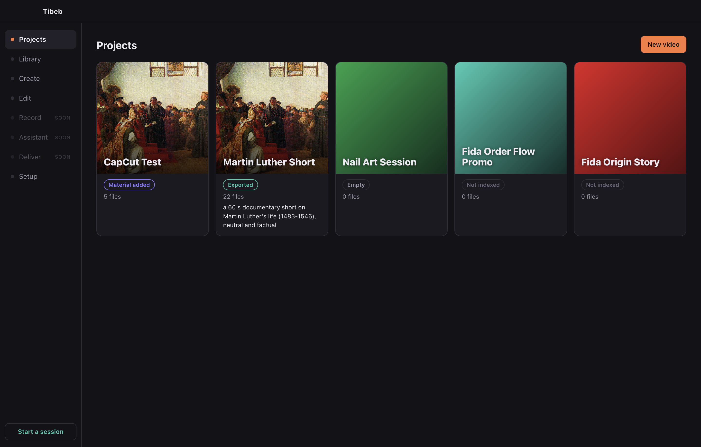
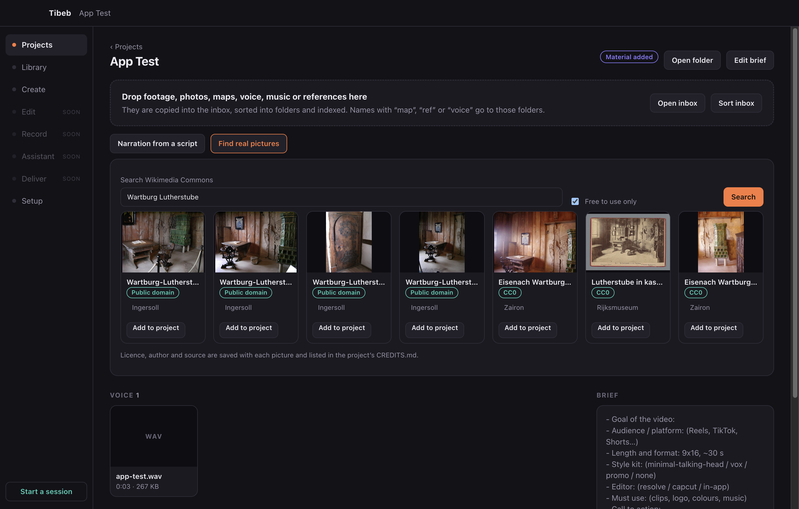
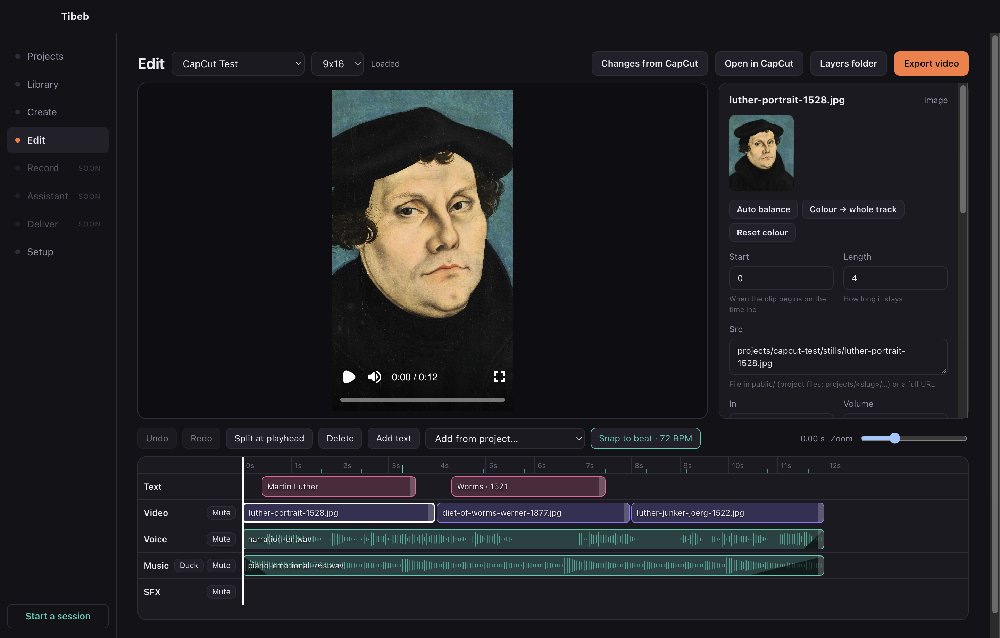
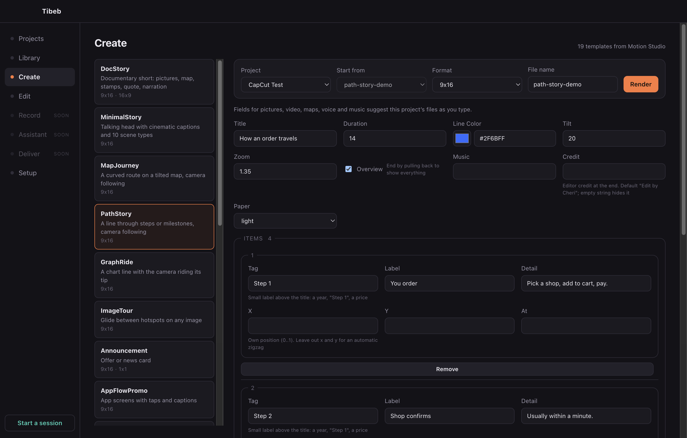
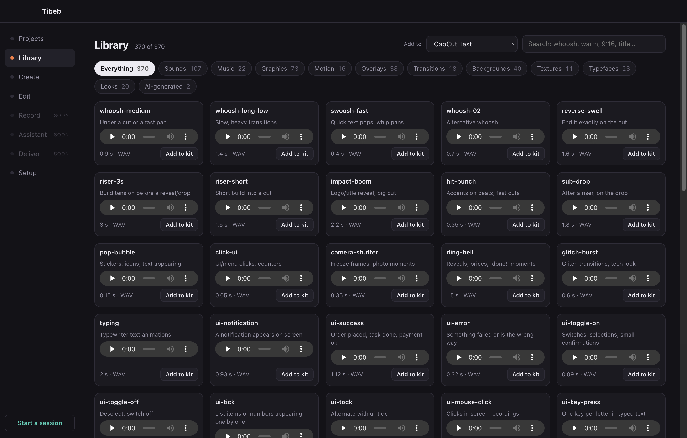
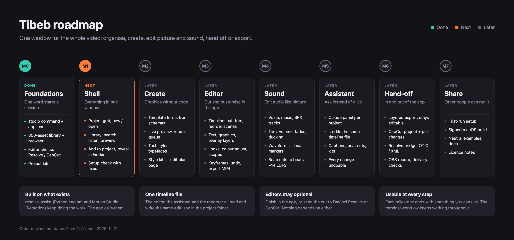
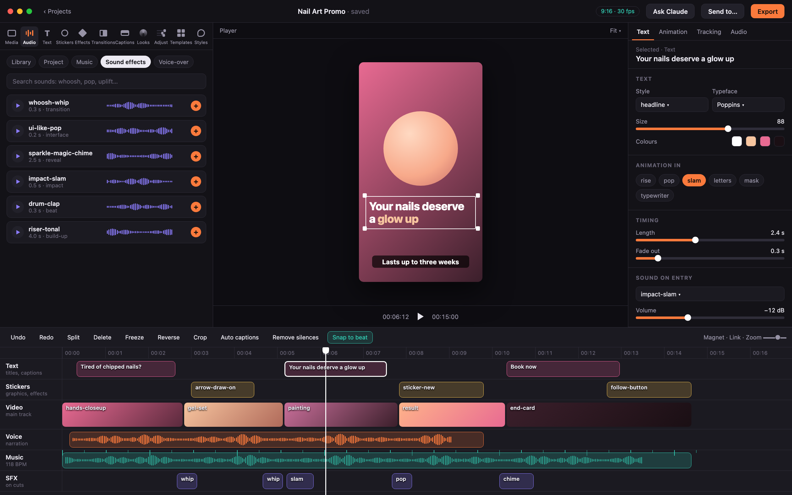

# Tibeb · a desktop studio for short-form video

**Tibeb** (ጥበብ, "craft") puts the whole job of making a short video in one window: gather the material,
pick sounds and graphics, build animated scenes from templates, and hand the result to an editor or
export it. It runs on your Mac, keeps your media on your disk, and works with an AI assistant without
depending on one.

> Status: early. Projects, Library, Create, a first Edit screen and Setup work today. Sound tools, colour,
> the assistant panel and editor hand-off are planned; see the [roadmap](#roadmap).



## What you can do today

| Screen | What it does |
|---|---|
| **Projects** | One folder per video. Create a project, see where each one stands (material added, prepared, planned, exported). |
| **Project** | Drop footage, photos, maps, voice, music or references onto the window: they are copied to the inbox, sorted into folders and indexed. The brief sits beside the files. |
| **Narration** | Inside a project: write a script, pick a voice (natural online voices incl. Amharic, or this Mac's offline voice), get the audio plus word timings and marker times for captions and scene timing. |
| **Find real pictures** | Inside a project: search Wikimedia Commons, see each picture's licence, add it with licence, author and source recorded in the project's `CREDITS.md`. |
| **Library** | 350 free-to-use assets generated on your machine: sound effects, music, graphics, animated overlays, transitions, backgrounds, textures, looks and open-licensed typefaces. Search, listen, preview, add to a project's kit. |
| **Create** | 18 video templates (documentary shorts, talking-head scenes, camera-follow maps, routes and graphs, promos, text overlays). Fill in a form (media fields suggest the project's own files, which are linked into the renderer automatically), press Render, the video lands in the project. |
| **Edit** (first version) | A timeline per project (`edit.json`): video, image, text and audio clips on tracks, with a live preview that uses the same renderer as the export. Drag clips to move them, drag the right edge to trim, split at the playhead, add text or project files, change any property in the inspector, undo/redo, autosave, export. Audio clips show their waveform, the music's beats are marked and edits snap to them. Picture clips take a colour look with a strength, exposure, contrast, saturation, temperature and tint, plus one-click auto balance. Music can dip automatically while the voice speaks. **Send to editor** exports the edit as layers (cut clips, each text as a transparent overlay, audio stems, looks, an OTIO/FCPXML timeline and a README) for Resolve or any editor. **Open in CapCut** (experimental) writes a real CapCut project with every clip on its own track and editable titles; **Changes from CapCut** reads back what you moved, trimmed, deleted or retyped there and applies it to the edit after you confirm. |
| **Setup** | Checks everything the studio needs and says how to fix what is missing. Choose your editor: DaVinci Resolve, CapCut or none. |






## How it fits together

Tibeb is the front door. Two other projects do the heavy work and stay usable on their own:

```
 Tibeb (this repo)            Electron + React: projects, library, forms, render queue
   ├─ resolve-assist          Python engine: asset library, captions, silence removal, beat analysis,
   │                          grading, OBS recording, DaVinci Resolve bridge, project intake
   └─ motion-studio           Remotion templates: text styles, typefaces, scene kits, camera-follow presets
```

Everything is a plain file in one workspace folder (`~/Documents/resolve-assist` by default):
`projects/<name>/` holds `inbox`, `footage`, `stills`, `maps`, `voice`, `music`, `exports`, a `brief.md`
and a `project.json` index; `library/` holds the assets and their manifest. Nothing is locked inside the app.

## Run it

Requirements: macOS, Node 20+, and the two sibling repos set up next to this one
(`../resolve-assist` with its `.venv`, `../motion-studio` with `npm install` done).

```bash
npm install
npm start          # build and open the app
npm test           # path-safety and project-store tests
npm run shots      # save a picture of every screen to docs/app/
node_modules/.bin/electron . --tools-test="App Test"    # narration + picture search through the app
node_modules/.bin/electron . --render-test="App Test"   # one template rendered through the app
node_modules/.bin/electron . --edit-test="App Test"     # first cut, save, reload and export through the editor
```

With the launcher from resolve-assist installed, `tibeb app` opens it from anywhere and `tibeb` starts an
assistant session in the workspace.

## Roadmap



| Stage | Contents | State |
|---|---|---|
| M0 Foundations | launcher, library, editor choice, project kits | done |
| M1 Shell | Projects, Library, Setup | done |
| M2 Create | template forms, render into a project | first version |
| M3 Editor | timeline: cut, trim, layers, looks, keyframes | first version (no keyframes yet) |
| M4 Sound | voice, music and SFX tracks, beats, ducking | waveforms, beats, snapping and ducking done |
| M5 Assistant | Claude panel working on the same timeline file | planned |
| M6 Hand-off | layered export, CapCut and Resolve, recording | layered export done (OTIO/FCPXML not yet opened in an editor); experimental CapCut project writer and read-back done; recording planned |
| M7 Share | first-run setup, signed build, docs | planned |

Details: [PLAN.md](PLAN.md) for the app and [INTERCHANGE.md](INTERCHANGE.md) for keeping AI and Remotion
work editable in CapCut and other editors.



*The editor picture is a design mock-up, not a screenshot.*

## Design rules

- **Local first.** Media never leaves the machine unless a feature says so. Two features go online and say so: natural narration voices (the script text goes to Microsoft) and the Wikimedia Commons picture search.
- **Files are the database.** Projects and the library are folders with small JSON indexes.
- **The editor is optional.** Finish in the app (planned), or hand off to DaVinci Resolve or CapCut.
- **Do the work once.** Transcripts, cuts, indexes and render settings are saved with the project and reused.
- **Safe by construction.** The page has no system access; it can only call a fixed list of functions,
  every file path is checked to stay inside the workspace, and helper programs are started with
  argument lists, never shell strings.

## Code map

```
src/main/       paths.ts (workspace + path guard) · store.ts (projects, library) · engine.ts (engine CLI)
                motion.ts (templates, renders, media linking) · edit.ts (edit.json) · main.ts (window, IPC, media:// protocol) · preload.ts
src/renderer/   App.tsx · SchemaForm.tsx (forms from template schemas) · screens/ (Projects, Project,
                Library, Create, Setup)
design/         mock-ups and diagrams, rendered to docs/ with Remotion
```

## Licence

MIT for this repository. The templates and the planned editor are built on
[Remotion](https://www.remotion.dev), which is free for individuals and teams of up to three people and
needs a company licence beyond that.
